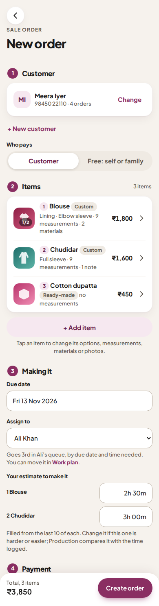
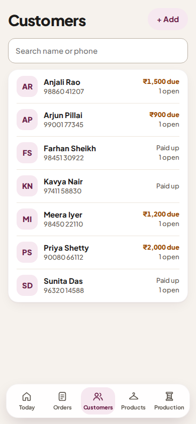
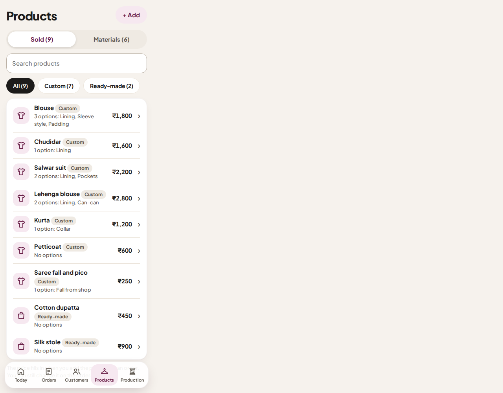
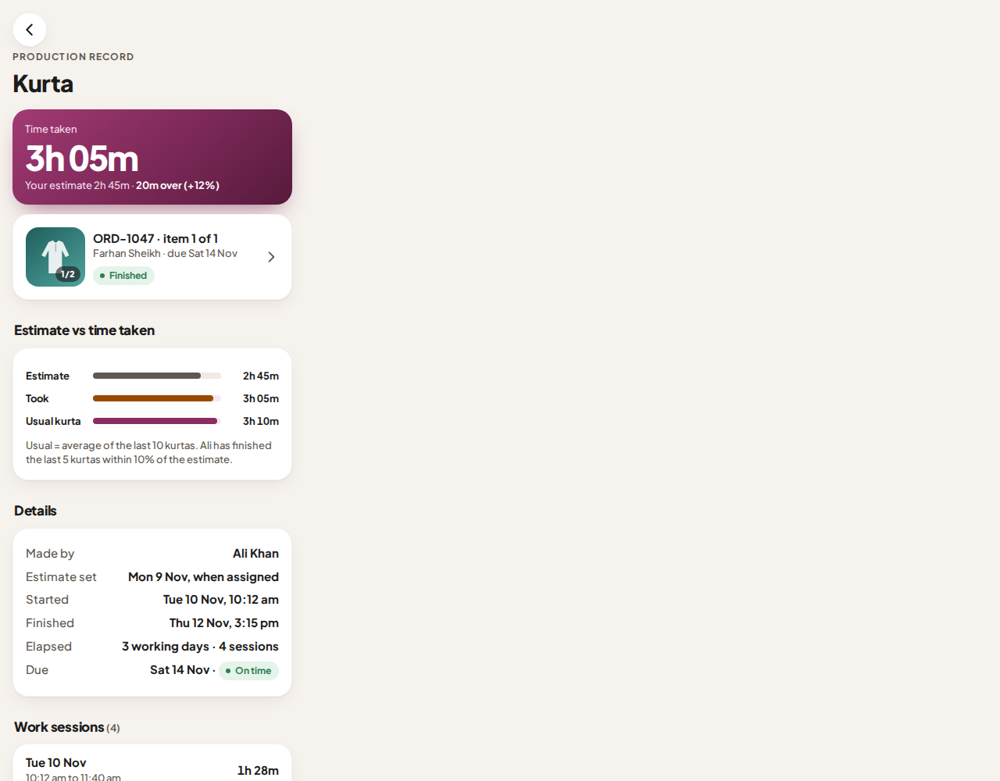

<!-- about -->

# Tailorly

**Orders, measurements, invoices and staff pay for a tailoring shop**

Website: [dmi.tabrez.xyz/p/tailorly](https://dmi.tabrez.xyz/p/tailorly)

## Screens

### S01 · Sign in

Sign in as the owner or the employee


### S02 · Today


### S03 · Orders

Find any order and see its status and balance


### S04 · Order Detail


### S05 · New order

Create a custom or ready-made order for a customer



### S06 · Customers

Find a customer and see who owes money



### S07 · Customer detail

A customer's details, measurements and orders


### S08 · My Work


### S09 · My Pay


### S10 · Staff


### S11 · Reports


### S12 · Production


### S13 · Payments


### S14 · Staff Report


### S15 · Products



### S16 · Work Plan


### S17 · Production Record



### S18 · Settings


### S19 · Item Detail


### S20 · Add item

Add one garment to a new order, or change it, with its product, price, options, measurements, materials, notes and photos


### S21 · Ai Assistants


<!-- /about -->

## Development

### Requirements

- [uv](https://docs.astral.sh/uv/) (installs Python 3.14)
- PostgreSQL 18
- Node 24 (only for formatting and re-vendoring; not needed to run the app)

### Setup

```
uv sync
npm ci
cp .env.example .env   # then edit it
createdb tailorly
set -a; . ./.env; set +a
uv run python manage.py migrate
```

### Run

```
set -a; . ./.env; set +a
uv run python manage.py runserver
```

### First setup

Create the owner account (asks for a password; the phone number is the username):

```
uv run python manage.py create_owner --phone "98450 12345" --name "Shop owner"
```

Use this command rather than `createsuperuser`: only accounts made here get the owner role.

### Password reset

The owner resets a forgotten password on this machine with `uv run python manage.py changepassword <phone>` (the username is the 10-digit phone number). Employees ask the owner.

### Pages and sheets

Every page view returns `render_page(request, template, {"title": ..., "tab": ...})` from `core/pages.py`: requests with the `HX-Request-Type: partial` header get the fragment, everything else gets the full shell. Sheets extend `components/sheet_content.html` and answer `sheet_saved(response, "toast text")` on success. A sheet that must refresh part of the page answers `sheet_saved_swap(response, "toast text", "#target")` instead. Pass `subpage=True` in the page context for a Settings sub-page: the bottom navigation is hidden.

### Demo data and drafts

```
uv run python manage.py seed_demo          # an empty shop gets demo products, customers and orders in every status
uv run python manage.py delete_old_drafts  # run daily; removes draft orders older than a day
```

### Vendor

```
npm run vendor
```

Copies the pinned htmx and Alpine builds into `static/vendor/`, with their versions in the file names, and the Plus Jakarta Sans font files and licence into `static/vendor/fonts/`. The output is committed, so Node isn't needed to run the app.

### Format

Write:

```
uv run ruff format . && uv run ruff check --fix . && uv run djlint --reformat templates && npx prettier --write .
```

Check (CI runs this on every pull request):

```
uv run ruff format --check . && uv run ruff check . && uv run djlint --check templates && npx prettier --check .
```

### Test

```
uv run pytest
uv run pytest --cov --cov-report=term-missing
```

End-to-end tests use Playwright. Install the browser once, then run them; screenshots go to `artifacts/screens/`:

```
uv run playwright install chromium
uv run pytest -m e2e
```

### Styleguide and icons

`/styleguide/` shows every shared component and works only with `DEBUG=1` (add `?theme=dark` to preview dark). After changing `static/brand/mark.svg`, re-render the PNG icons:

```
uv run python scripts/render_icons.py
```

Amounts are in rupees (INR) with no tax.

---

<sub>Created with ❤️ by Dunder Mifflin agents</sub>
