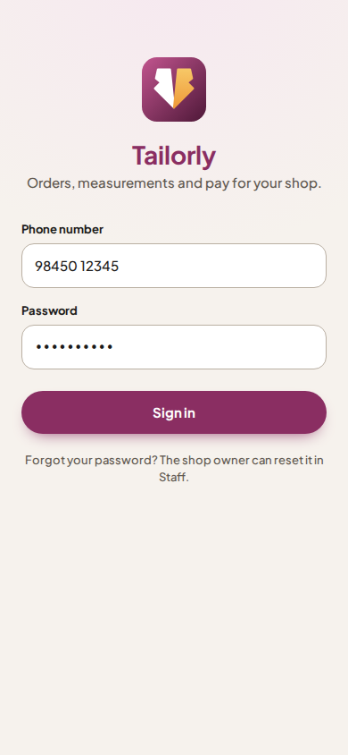
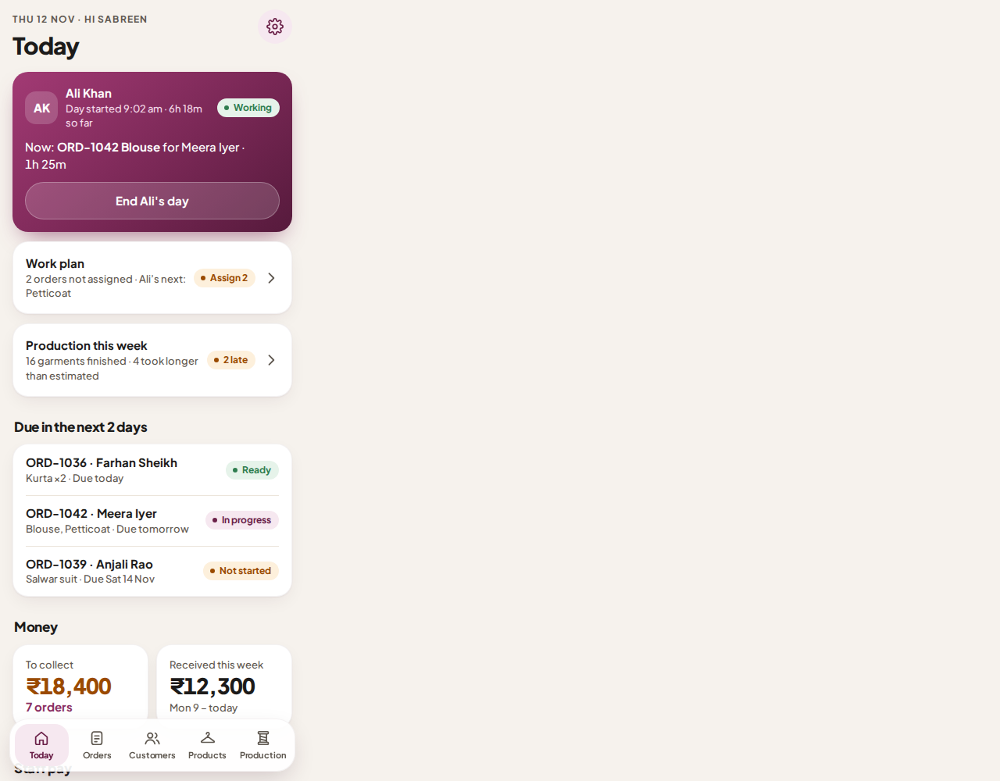
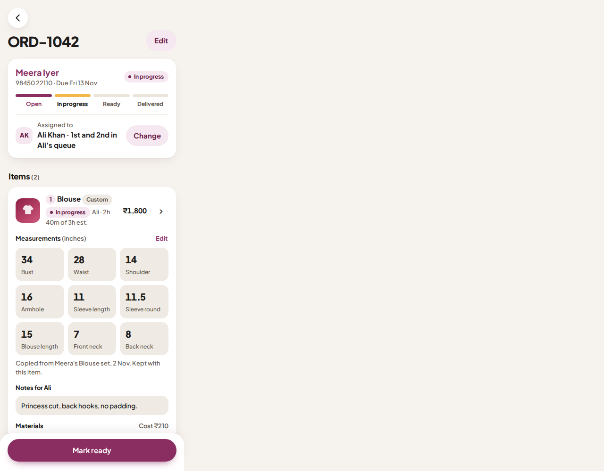
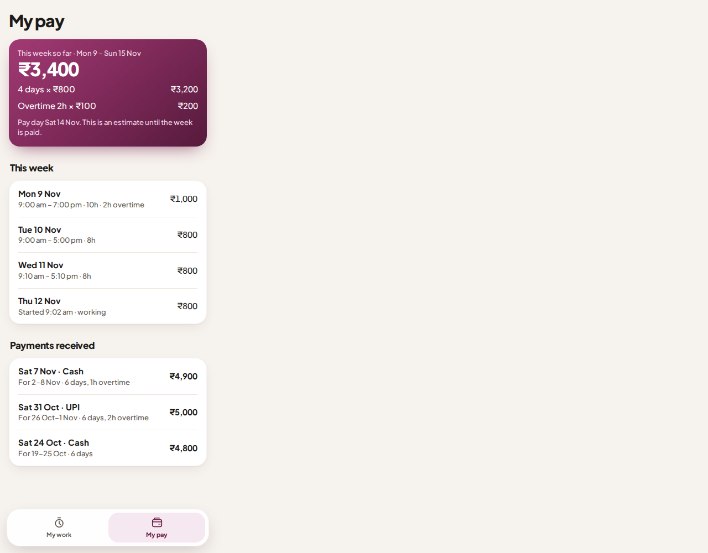
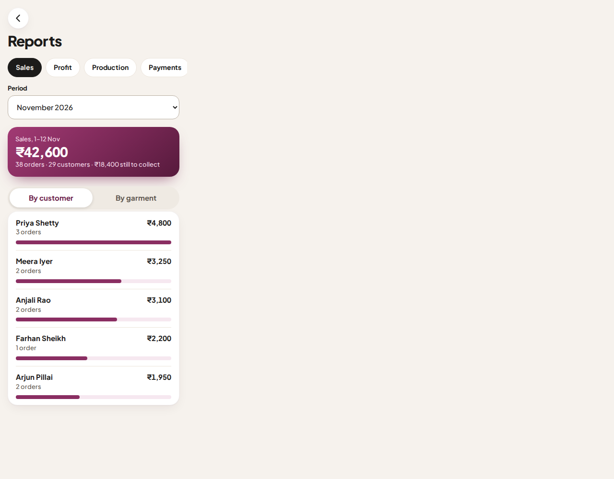
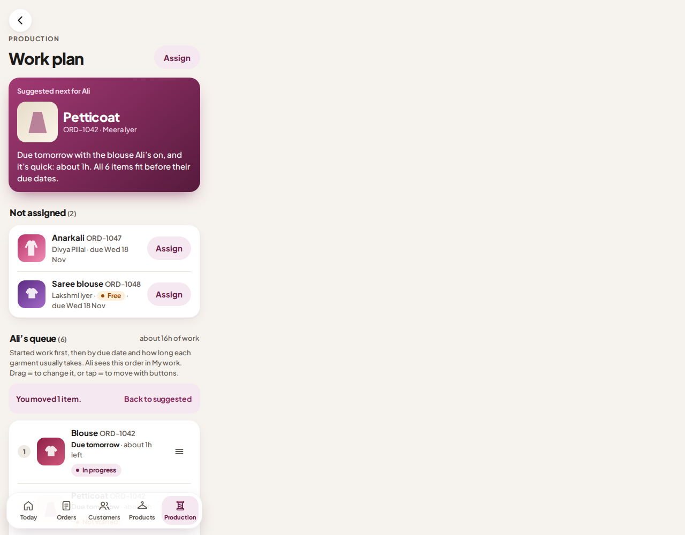
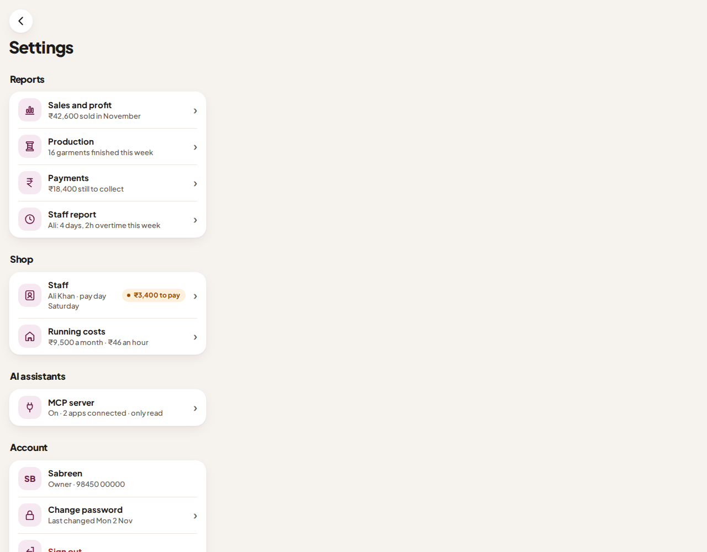
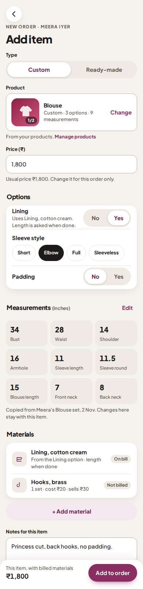

<!-- about -->

# Tailorly

**Orders, measurements, invoices and staff pay for a tailoring shop**

Website: [dmi.tabrez.xyz/p/tailorly](https://dmi.tabrez.xyz/p/tailorly)

## Screens

### S01 · Sign in

Sign in as the owner or the employee



### S02 · Today



### S03 · Orders

Find any order and see its status and balance


### S04 · Order Detail



### S05 · New order

Create a custom or ready-made order for a customer


### S06 · Customers

Find a customer and see who owes money


### S07 · Customer detail

A customer's details, measurements and orders


### S08 · My Work


### S09 · My Pay



### S10 · Staff


### S11 · Reports



### S12 · Production


### S13 · Payments


### S14 · Staff Report


### S15 · Products


### S16 · Work Plan



### S17 · Production Record


### S18 · Settings



### S19 · Item Detail


### S20 · Add item

Add one garment to a new order, or change it, with its product, price, options, measurements, materials, notes and photos



### S21 · Ai Assistants


<!-- /about -->

## Development

### Requirements

- [uv](https://docs.astral.sh/uv/) (installs Python 3.14)
- PostgreSQL 18
- Node 24 (only for formatting and re-vendoring; not needed to run the app)

### Setup

```
uv sync
npm ci
cp .env.example .env   # then edit it
createdb tailorly
set -a; . ./.env; set +a
uv run python manage.py migrate
```

`SHOP_NAME` in `.env` is the first line of the invoice sent on WhatsApp. It moves to shop settings when that screen is built.

### Run

```
set -a; . ./.env; set +a
uv run python manage.py runserver
```

### MCP server

```
set -a; . ./.env; set +a
uv run python manage.py run_mcp   # http://127.0.0.1:8001/mcp
```

It answers only while the MCP server switch on Settings > AI assistants is on, with an access key from that page sent as `Authorization: Bearer <key>`. The tunnel routes `/mcp` to port 8001; set `MCP_SERVER_URL` to the public address so its host is accepted. Tools list only what the "What it can see" switches allow.

### First setup

Create the owner account (asks for a password; the phone number is the username):

```
uv run python manage.py create_owner --phone "98450 12345" --name "Shop owner"
```

Use this command rather than `createsuperuser`: only accounts made here get the owner role.

### Password reset

The owner resets a forgotten password on this machine with `uv run python manage.py changepassword <phone>` (the username is the 10-digit phone number). Employees ask the owner.

### Pages and sheets

Every page view returns `render_page(request, template, {"title": ..., "tab": ...})` from `core/pages.py`: requests with the `HX-Request-Type: partial` header get the fragment, everything else gets the full shell. Sheets extend `components/sheet_content.html` and answer `sheet_saved(response, "toast text")` on success. A sheet that must refresh part of the page answers `sheet_saved_swap(response, "toast text", "#target")` instead. Pass `subpage=True` in the page context for a Settings sub-page: the bottom navigation is hidden.

### Demo data and drafts

```
uv run python manage.py seed_demo          # an empty shop gets demo products, customers and orders in every status
uv run python manage.py delete_old_drafts  # removes draft orders older than a day; the backup timer runs it nightly in production
```

### Vendor

```
npm run vendor
```

Copies the pinned htmx and Alpine builds into `static/vendor/`, with their versions in the file names, and the Plus Jakarta Sans font files and licence into `static/vendor/fonts/`. The output is committed, so Node isn't needed to run the app.

### Format

Write:

```
uv run ruff format . && uv run ruff check --fix . && uv run djlint --reformat templates && npx prettier --write .
```

Check (CI runs this on every pull request):

```
uv run ruff format --check . && uv run ruff check . && uv run djlint --check templates && npx prettier --check .
```

### Secret scan

CI scans the whole git history with [betterleaks](https://github.com/betterleaks/betterleaks) on every pull
request and fails on any finding. To run the same scan locally, install the version pinned in
`.github/workflows/ci.yml` and run from a full (non-shallow) clone:

```
betterleaks git . --redact --verbose --exit-code 1 --config .betterleaks.toml
```

Fake values in tests and examples are allowlisted in `.betterleaks.toml`, and a real secret anywhere else still
fails the build.

To update the pin, set `BETTERLEAKS_VERSION` in `.github/workflows/ci.yml` to the latest stable release and
`BETTERLEAKS_SHA256` to the sha256 of `betterleaks_<version>_linux_x64.tar.gz` from that release's checksums
file. Change both together.

### Test

```
uv run pytest
uv run pytest --cov --cov-report=term-missing
```

End-to-end tests use Playwright. Install the browser once, then run them; screenshots go to `artifacts/screens/`:

```
uv run playwright install chromium
uv run pytest -m e2e
```

### Styleguide and icons

`/styleguide/` shows every shared component and works only with `DEBUG=1` (add `?theme=dark` to preview dark). After changing `static/brand/mark.svg`, re-render the PNG icons:

```
uv run python scripts/render_icons.py
```

Amounts are in rupees (INR) with no tax.

## Deployment

### What runs

| Unit                    | What                                              | Where                    |
| ----------------------- | ------------------------------------------------- | ------------------------ |
| `tailorly-web`          | gunicorn, 2 workers                               | 127.0.0.1:8000           |
| `tailorly-mcp`          | MCP server (`manage.py run_mcp`)                  | 127.0.0.1:8001           |
| `tailorly-backup.timer` | database dump + media archive, then draft cleanup | every night at 02:30 IST |

Cloudflare Tunnel (`cloudflared`) publishes one HTTPS hostname: `/mcp` goes to port 8001 and everything else to port 8000 (`deploy/cloudflared.example.yml`).

### Install

Install PostgreSQL 18 from the [PostgreSQL apt repository](https://www.postgresql.org/download/linux/), create the `tailorly` user, check out the app and install it. uv installs Python 3.14 from `.python-version`; install uv for the `tailorly` user first.

```
sudo apt install postgresql-18
sudo useradd --system --create-home tailorly
sudo install -d -o tailorly -g tailorly /srv/tailorly
sudo -u tailorly git clone <repo> /srv/tailorly
cd /srv/tailorly && sudo -u tailorly uv sync --locked --no-dev
sudo -u postgres createuser tailorly && sudo -u postgres createdb -O tailorly tailorly
sudo mkdir -p /etc/tailorly /var/lib/tailorly/media /var/backups/tailorly
sudo chown tailorly: /var/lib/tailorly/media /var/backups/tailorly
sudo cp deploy/production.env.example /etc/tailorly/tailorly.env
```

Edit `/etc/tailorly/tailorly.env`, then `sudo chown root:tailorly /etc/tailorly/tailorly.env && sudo chmod 640 /etc/tailorly/tailorly.env`.

### Production settings checklist

- `DEBUG=0`.
- A new `SECRET_KEY` (the command is in the example file).
- `ALLOWED_HOSTS` is the tunnel hostname; `CSRF_TRUSTED_ORIGINS` is `https://` plus the hostname.
- `SECURE_SSL_REDIRECT=1` and `SECURE_HSTS_SECONDS` set (Cloudflare sends `X-Forwarded-Proto`).
- `MCP_SERVER_URL` is `https://<hostname>/mcp`.
- `ASSET_VERSION` is written on every release (see First start); it lives in `/etc/tailorly/release.env`, not in the env file.

Verify:

```
set -a; . /etc/tailorly/tailorly.env; set +a
.venv/bin/python manage.py check --deploy --fail-level WARNING
```

### First start

As `tailorly`, with the env loaded as above:

```
.venv/bin/python manage.py migrate
.venv/bin/python manage.py collectstatic --noinput
.venv/bin/python manage.py create_owner --phone "98450 12345" --name "Shop owner"
echo "ASSET_VERSION=$(git rev-parse --short HEAD)" | sudo tee /etc/tailorly/release.env
sudo cp deploy/tailorly-*.service deploy/tailorly-backup.timer /etc/systemd/system/
sudo systemctl daemon-reload
sudo systemctl enable --now tailorly-web tailorly-mcp tailorly-backup.timer
```

### Cloudflare Tunnel

Install `cloudflared`, then:

```
cloudflared tunnel login
cloudflared tunnel create tailorly
cloudflared tunnel route dns tailorly shop.example.com
sudo install -d -m 700 /etc/cloudflared
sudo install -m 600 ~/.cloudflared/<TUNNEL-ID>.json /etc/cloudflared/
sudo cp deploy/cloudflared.example.yml /etc/cloudflared/config.yml   # then edit the placeholders
sudo cloudflared --config /etc/cloudflared/config.yml service install
```

The credentials JSON stays in `/etc/cloudflared/`, never in the repo (`deploy/*.json` is git-ignored).

### Update to a new release

```
git pull --ff-only
uv sync --locked --no-dev
set -a; . /etc/tailorly/tailorly.env; set +a
.venv/bin/python manage.py migrate
.venv/bin/python manage.py collectstatic --noinput
echo "ASSET_VERSION=$(git rev-parse --short HEAD)" | sudo tee /etc/tailorly/release.env
sudo systemctl restart tailorly-web tailorly-mcp
```

Open phones see the new asset version and reload the shell once.

### Backups

Each night `manage.py backup` writes `tailorly-<stamp>.dump` and `tailorly-<stamp>-media.tar.gz` to `/var/backups/tailorly`, keeps the newest 14, and then `delete_old_drafts` runs. If the backup fails, the cleanup is skipped. Run one now and read the log:

```
sudo systemctl start tailorly-backup
journalctl -u tailorly-backup
```

Copy `/var/backups/tailorly` off the machine regularly.

### Restore from a backup

```
sudo -u tailorly pg_restore --list /var/backups/tailorly/tailorly-<stamp>.dump > /dev/null \
  && sudo -u tailorly tar -tzf /var/backups/tailorly/tailorly-<stamp>-media.tar.gz > /dev/null \
  && sudo systemctl stop tailorly-web tailorly-mcp tailorly-backup.timer tailorly-backup \
  && sudo -u postgres dropdb tailorly \
  && sudo -u postgres createdb -O tailorly tailorly \
  && sudo -u tailorly pg_restore --no-owner --single-transaction --exit-on-error --dbname=tailorly /var/backups/tailorly/tailorly-<stamp>.dump \
  && sudo rm -rf /var/lib/tailorly/media \
  && sudo install -d -o tailorly -g tailorly /var/lib/tailorly/media \
  && sudo -u tailorly tar -xzf /var/backups/tailorly/tailorly-<stamp>-media.tar.gz -C /var/lib/tailorly \
  && sudo systemctl start tailorly-web tailorly-mcp tailorly-backup.timer
```

Both files are checked before anything stops. If `pg_restore` fails after `dropdb`, the database is empty, the media is untouched and everything stays stopped. Fix the cause and rerun from `createdb`.

Try a restore first on a scratch database:

```
sudo -u postgres createdb -O tailorly tailorly_restore_check
sudo -u tailorly pg_restore --no-owner --dbname=tailorly_restore_check <dump>
sudo -u tailorly psql -d tailorly_restore_check -c "select count(*) from django_migrations"
sudo -u postgres dropdb tailorly_restore_check
```

---

<sub>Created with ❤️ by Dunder Mifflin agents</sub>
